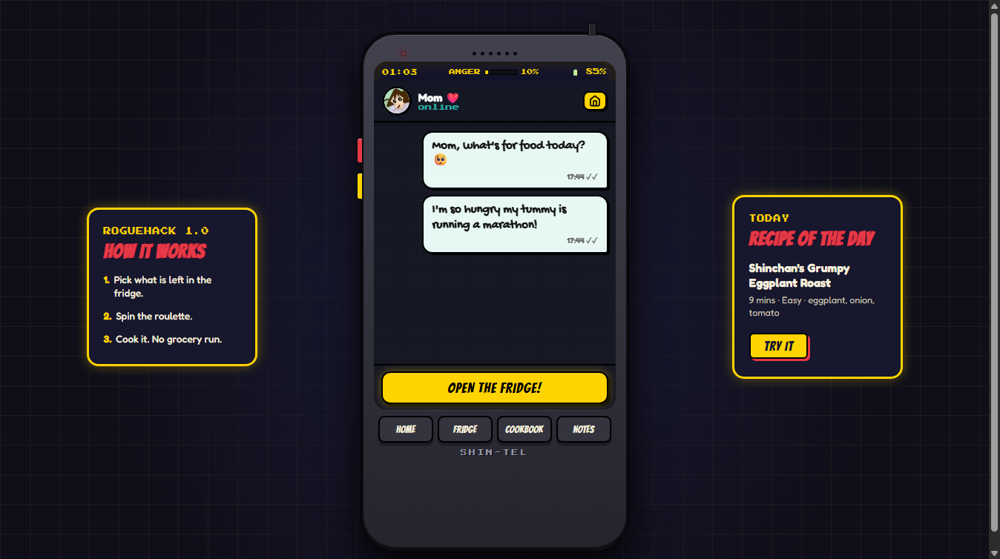
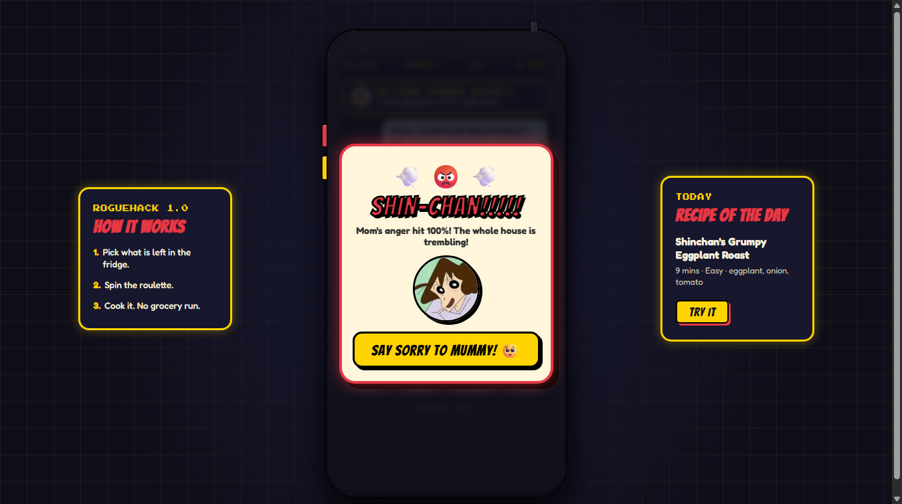
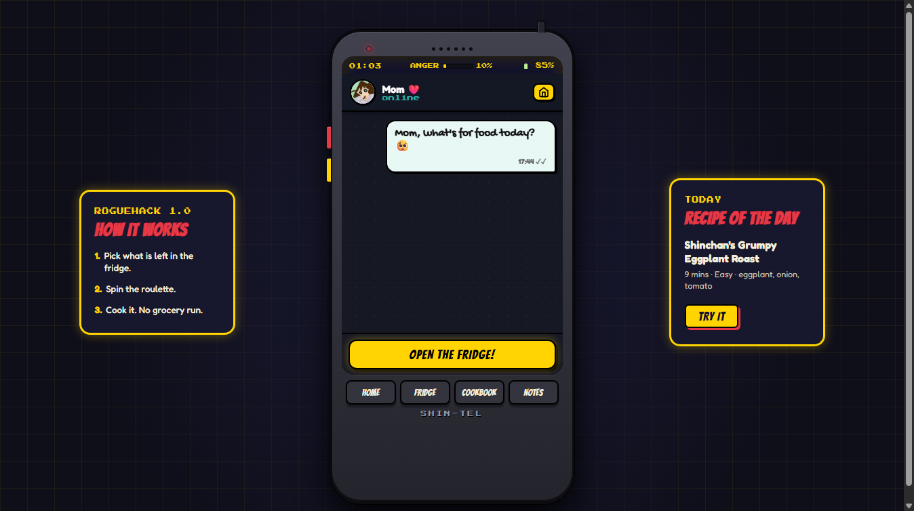
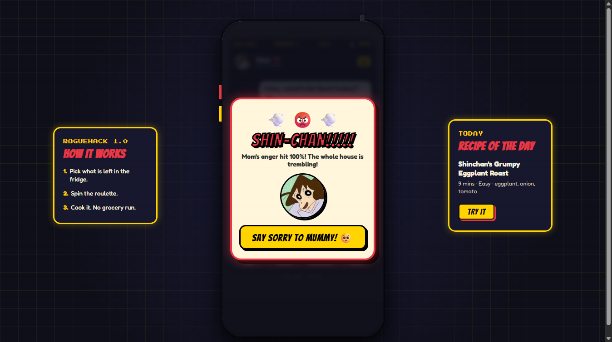

<p align="center">
  
</p>

# Recipe Roulette: Shinchan Edition 📱🍜

An interactive, dark retro 90s handheld gadget ("SHIN-TEL") and comic-styled survival recipe generator built as Shinchan's Phone OS, turning leftover kitchen ingredients into delicious local and global meals with authentic Shinchan humor!

---

## 🏆 Hackathon Context

- **Event:** ROGUEHACK 1.0
- **Organized By:** Hack The Box SRMIST Student Chapter
- **Theme:** Shinchan (Crayon Shin-chan / クレヨンしんちゃん)
- **Problem Track:** Recipe Roulette — Empty Fridge Survival Guide

---

## 🌟 Key Features

### 1. 📟 Retro 90s Handheld Gadget ("SHIN-TEL")
- **Hardware Chassis**: Authentic chunky 90s electronic handheld styling with an extending antenna, speaker grille, blinking power LED, and stamped `SHIN-TEL` branding.
- **Physical Side Buttons**: Interactive red power button (`#btn-side-power`) and yellow action button (`#btn-side-func`) on the gadget's chassis.
- **Physical Bottom Nav Keys**: Chunky tactile buttons (`HOME`, `FRIDGE`, `COOKBOOK`, `NOTES`) with keyboard navigation and active glow effects.
- **Status Bar & Live Anger Meter**: Real-time clock, battery percentage indicator, and **Mom's Live Anger Meter** that escalates when Shinchan picks hated veggies or misbehaves.
- **Ambient Arcade Side Panels**:
  - **Left Panel ("HOW IT WORKS")**: ROGUEHACK 1.0 3-step survival guide.
  - **Right Panel ("RECIPE OF THE DAY")**: Daily randomized recipe (seeded per calendar day) with an instant **"TRY IT"** button that loads the dish directly into the roulette.

### 2. 📱 Interactive Phone Home Screen (9-App Grid)
- 🧊 **Fridge**: Recipe Roulette with slot machine reel spinner, smart ingredient chips, and dish cards.
- 👩 **Mom (Misae)**: Replayable chat messenger where Shinchan begs for Chocobi and Mom orders him to cook leftovers.
- ⚡ **Kamen TV**: Interactive Action Kamen TV with a clickable Action Beam blaster and hero sound effects.
- 🐶 **Shiro**: Interactive pet simulator and polaroid memory photo gallery.
- 📝 **Notes**: Shinchan's personal notepad with handwriting font, quick notes, and a doodle scribble generator.
- 📖 **Cookbook**: Persistent log recording all cooked dishes, timestamps, custom notes, and Mummy's verdicts.
- ☀️ **Weather**: Kasukabe forecast ("*90% chance of Mom yelling, 100% chance of Chocobi*").
- 👥 **Contacts (Speed Dial)**: Phonebook with custom character avatars for Mom, Dad (Hiroshi), Kazama, Nanako-san, Shiro, and Action Kamen.
- ⚙️ **Settings**: Web Audio toggle, Anger meter controls, Power Off/Restart triggers, test tools, and storage clearing.

### 3. 🐶 Shiro's Pet Care Loop & Memory Gallery
- **Original Fluffy Dog SVG**: Fully interactive custom SVG pet with distinct clickable body parts (head, ears, belly, tail).
- **Petting Reactions**: Petting any area triggers unique bouncing animations, sound effects, and 15+ hilarious Shinchan voice bubbles.
- **Care Stats & Decay**: Tracks **Hunger**, **Happiness**, and **Energy** (0-100) with realistic time decay (capped at 4 hours offline) and live updates every 15 seconds.
- **Dynamic Mood Engine**: Automatically transitions between **Happy**, **Playful**, **Hungry**, and **Sleepy** based on local time and pet stats.
- **"Give Shiro a Bite"**: Feeds Shiro leftovers from the latest cooked dish in your Cookbook. Ingredients trigger authentic reactions (spicy ingredients prompt "too spicy!", sweet dishes delight him, and overfeeding makes him sleepy).
- **Polaroid Memory Gallery**: Features polaroid photos of Shiro's iconic moments (*Shiro Cotton Candy*, *Bone Guardy dog*, *Walking himself*, *Nap time in dog house*).

### 4. ⚡ Power Management, 0% Battery & Retro BIOS Boot
- **Hardware Power Menu**: Pressing the red chassis button opens the SHIN-TEL Power Menu modal with **Power Off**, **Restart Phone**, and **Cancel**.
- **Power Off Sequence**: Shuts down the screen with a retro CRT monitor animation, darkens the gadget LED, and displays the powered-off standby state.
- **Retro 90s BIOS Boot Screen**: Initiates a green phosphor terminal boot sequence checking 640KB RAM, Kasukabe chipset, and Action Bastard ROM before launching Kasukabe OS with a boot fanfare.
- **0% Battery Shutdown & Interactive Charger**: Repeated roulette spins drain the battery. At 0%, the phone shuts down completely with a dead battery alert, requiring the user to plug in the interactive charger to reboot.

### 5. 🍲 Smart Recipe Roulette & World Kitchen Engine
- **50 Handcrafted Local Recipes**: Curated in `data/recipes.json`, including 15 Indian & Desi hostel survival staples (*Masala Omelette*, *Anda Bhurji*, *Dahi Tadka*, *Paneer Tikka*, *Curd Rice Tadka*, etc.).
- **World Kitchen 🌍 Mode**: Hybrid integration with TheMealDB API (`filter.php` multi-ingredient frequency ranking + `lookup.php` full dish details) with in-memory caching and offline fallback.
- **Tappable Ingredient Chips & Custom Additions**: Quickly select leftovers from your fridge or type custom ingredients.
- **Hated Ingredient Alarm**: Selecting green pepper (*piman*) or eggplant (*brinjal*) triggers Shinchan's dramatic tantrum, a red screen flash, and increases Mom's Anger Meter by +35%.
- **Mom's 100% Rage Event**: Intense screen shaking with the iconic *"SHIN-CHAN!!!!!"* modal when Mom's patience runs out.
- **Periodic Slide-down Notifications**: Interactive slide-in notification banners every ~15 seconds with quips and custom avatars from Hiroshi, Kazama, Nanako-san, Shiro, and Action Kamen.

### 6. 🔊 Pure Web Audio API Synthesis
- **Zero External Audio Files**: All sound effects (button clicks, roulette reels, fanfare, alarm, Action Kamen beam, and Shiro's bark, pant, yawn, and happy blips) are synthesized in real-time via the Web Audio API.
- **Audio Toggle Compliance**: Synchronized mute/unmute toggles in the status bar and Settings app.

### 7. 💾 Full Persistent Storage (`localStorage`)
- Remembers visitor history, cooked recipes, Shiro pet state, favorites, and settings across browser sessions.
- Wrapped in resilient `try/catch` handlers with seamless in-memory fallbacks if storage is restricted.

---

## 🛠️ Tech Stack

- **Frontend:** Semantic HTML5, Modern CSS3 (CSS Grid, Flexbox, custom retro animations, CRT effects, Google Fonts: *Bangers*, *Fredoka*, *Gochi Hand*, *Press Start 2P*)
- **Logic:** Vanilla ES6+ JavaScript (Zero external runtime dependencies or build tools)
- **Audio:** Web Audio API (`AudioContext`, `OscillatorNode`, `GainNode`, `BiquadFilterNode`)
- **API:** TheMealDB API (World Kitchen integration)
- **Quality & Contrast:** WCAG AA compliant ($\ge 4.5:1$ contrast ratio), `prefers-reduced-motion` support
- **Hosting:** Vercel (Zero-config static deployment)

---

## 📂 Project Structure

```text
yeahHTBHackathon/
├── index.html                       <- Main HTML document (Vercel entrypoint)
├── vercel.json                      <- Vercel deployment configuration
├── .vercelignore                    <- Deployment exclusions
├── .gitignore                       <- Git ignore rules
├── README.md                        <- Project documentation
├── css/
│   └── style.css                    <- Complete 90s handheld gadget styling & CRT animations
├── js/
│   └── script.js                    <- Core app logic, Web Audio synthesis, and phone OS state
├── data/
│   └── recipes.json                 <- 50 curated local recipes (including Indian hostel staples)
├── assets/
│   └── images/
│       ├── avatars/                 <- Character profile avatars (Misae, Shinchan, Hiroshi, Kazama, Nanako, Shiro, Action Kamen)
│       ├── icons/                   <- Favicon set (favicon.ico, favicon.svg, favicon-32.png, apple-touch-icon.png, logo-512.png)
│       └── shiro/                   <- Shiro polaroid gallery photos (cotton candy, bone guard, walk, nap time)
├── docs/
│   └── screenshots/                 <- High-resolution project screenshots for documentation
└── tests/
    └── test_app.py                  <- Automated end-to-end browser verification suite (Playwright/CDP)
```

---

## 💻 How to Run Locally

Because the application fetches `data/recipes.json` asynchronously, run it using a local HTTP server:

```bash
# Clone the repository
git clone https://github.com/n0TSaumyaShaw/Recipe_Roulette.git
cd Recipe_Roulette

# Start a local static server (Python 3)
python -m http.server 8080
```

Now open your browser and navigate to:
**`http://localhost:8080/`**

---

## 📸 Screenshots

| Recipe Roulette (Fridge) | World Kitchen Mode |
|:---:|:---:|
|  |  |

| Shiro's Pet Care & Gallery | Kasukabe Contacts (Speed Dial) |
|:---:|:---:|
|  |  |

| Phone Home Screen | Mom's 100% Rage Modal |
|:---:|:---:|
|  |  |

---

## 📜 Credits & Disclaimer

- **Recipe Data:** [TheMealDB](https://www.themealdb.com/) for public World Kitchen meal data and ingredients.
- **Fonts:** [Google Fonts](https://fonts.google.com/) (*Bangers*, *Fredoka*, *Gochi Hand*, *Press Start 2P*, *Comic Neue*).
- **Disclaimer:** This is an unofficial, non-commercial fan-made project created solely for the **ROGUEHACK 1.0** hackathon. *Crayon Shin-chan* and all related characters and trademarks are the property of Yoshito Usui, Futabasha, Shin-Ei Animation, and TV Asahi. No copyright infringement is intended.

---

## 👤 Author

- **Name:** Saumya Shaw
- **Hackathon Team:** Exodus (Members: Only me)
- **Institution:** SRM Institute of Science and Technology (SRMIST)
- **GitHub:** [@n0TSaumyaShaw](https://github.com/n0TSaumyaShaw)
